# dotfiles

今の WSL / bash 環境を復元するための dotfiles。

旧 `WakuwakuP/dotfiles`（zsh / windyakin 系）と、実環境で使っていた `dotfiles-old` を、現在のカスタムに合わせて作り直している。

## 入っているもの

- bash（モジュール分割）
- tmux（prefix `C-t`、Vim キー、win32yank、tpm）
- git（YubiKey による SSH 署名または GPG 署名、gh credential、ghq root。既定値 `~/ghq`）
- fzf（PowerShell の `g` と同等の ghq プレビュー） / starship / nano / gh CLI 設定
- Cursor ユーザールールとプラグイン一覧

## 入れていないもの

SSH 鍵、実ホストの `~/.ssh/config`、GPG 秘密鍵、`gh` のトークン、`.local` のキャッシュはリポジトリに入れない。GitHub / SSH / GPG は対話セットアップから端末へ安全に設定できる。

## Quick start

### 初回セットアップ（対話式）

次のコマンドだけで `~/.dotfiles` への clone とセットアップを実行する。

```bash
curl -fsSL https://raw.githubusercontent.com/WakuwakuP/dotfiles/master/install.sh | bash
```

### clone 済みの場合

リポジトリのディレクトリで実行する。

```bash
./setup.sh
```

### 非対話でセットアップ

初回セットアップをすべて既定値で実行する。

```bash
curl -fsSL https://raw.githubusercontent.com/WakuwakuP/dotfiles/master/install.sh | bash -s -- --yes
```

clone 済みの場合はこちら。

```bash
./setup.sh --yes
```

### セットアップ内容

`setup.sh` は次を順に確認する。ghq の保存先は対話時に変更でき、端末固有の設定として `~/.config/git/ghq.gitconfig` に保存される。初回の既定値は `~/ghq` で、再実行時は現在の設定値を維持する。

1. 設定ファイルのシンボリックリンク（既存は `~/.dotfiles-backup-*` に退避）
2. apt パッケージ（`tmux fzf bat gh git gpg openssh-client bash-completion`、あれば `lsd`）
3. `ghq` とリポジトリ保存先（既定値 `~/ghq`）
4. tmux plugin manager（tpm / tmux-sensible）
5. WSL 用 `win32yank.exe`
6. `starship`（`powerline-shell` の代替。プロンプトが速い）
7. Cursor ルールを `~/.cursor/rules` へ
8. GitHub / SSH / GPG の機密情報セットアップ（対話実行時のみ）
9. Ubuntu 再起動通知（Discord）設定（任意。`scripts/check-reboot.sh` の設定）

### 対話セットアップのフロー

`install.sh` から実行した場合も、clone または更新後に同じフローへ入る。通常セットアップの1〜7は既定で `Yes`、機密情報（8）および再起動通知（9）は既定で `No`、`--yes` 実行時は 8/9 の両方をスキップする。

```mermaid
flowchart TD
    Start([setup.sh を開始]) --> Q1{"1/9 設定ファイルをリンクする?"}
    Q1 -->|Yes| A1[既存設定をバックアップしてシンボリックリンク]
    Q1 -->|No| Q2
    A1 --> Q2{"2/9 apt パッケージをインストールする?"}

    Q2 -->|Yes| A2[tmux・fzf・bat・gh・git・gpg などをインストール]
    Q2 -->|No| Q3
    A2 --> Q3{"3/9 ghq をインストールして保存先を設定する?"}

    Q3 -->|No| Q4
    Q3 -->|Yes| G1[ghq をインストール]
    G1 --> G2[保存先を入力 現在値または初回 ~/ghq]
    G2 --> G3{"保存先の状態"}
    G3 -->|通常のファイル| Error([エラーで終了])
    G3 -->|ディレクトリが存在| G6[ghq.root を保存]
    G3 -->|存在しない| G4{"保存先を作成する?"}
    G4 -->|Yes| G5[ディレクトリを作成]
    G4 -->|No| G6
    G5 --> G6
    G6 --> Q4{"4/9 tmux プラグインをインストールする?"}

    Q4 -->|Yes| A4[tpm と tmux-sensible をインストール]
    Q4 -->|No| Q5
    A4 --> Q5{"5/9 WSL 用 win32yank.exe をインストールする?"}

    Q5 -->|Yes| A5[WSL なら win32yank.exe をインストール]
    Q5 -->|No| Q6
    A5 --> Q6{"6/9 starship をインストールする?"}

    Q6 -->|Yes| A6[starship をインストール]
    Q6 -->|No| Q7
    A6 --> Q7{"7/9 Cursor ルールをリンクする?"}

    Q7 -->|Yes| A7[Cursor ルールをリンク]
    Q7 -->|No| Q8
    A7 --> Q8{"8/9 機密情報をセットアップする?"}

    Q8 -->|No| Q9{"9/9 再起動通知を設定する?"}
    Q8 -->|Yes| C1{"GitHub 認証を設定する?"}
    C1 -->|Yes| C1A[GitHub.com の認証を確認し未認証なら gh auth login]
    C1 -->|No| C2
    C1A --> C2{"SSH 鍵と設定を復元する?"}
    C2 -->|Yes| C2A[復元元を入力]
    C2 -->|No| C3
    C2A --> C2B{"バックアップ付きで ~/.ssh を置換する?"}
    C2B -->|Yes| C2C[既存設定を退避して復元]
    C2B -->|No| C3
    C2C --> C3{"Git の署名方式を選択"}
    C3 -->|YubiKey| YK[Nano または NFC を選び、鍵を取り込み・作成・再利用]
    YK --> YKS[SSH 接続と Git 署名に選んだ鍵を設定]
    YKS --> Q9
    C3 -->|GPG| GPG[既存の GPG 鍵を使用、必要なら照合してインポート]
    GPG --> GS[Git 署名に OpenPGP を設定]
    GS --> Q9
    C3 -->|現在の設定を維持| Q9

    Q9 -->|No| Notes
    Q9 -->|Yes| R1[不足する依存をaptで導入]
    R1 --> R2[Webhook URLを非表示入力 空入力なら有効な既存設定を再利用]
    R2 --> R3{"有効なURLがある?"}
    R3 -->|未設定かつ空入力| Notes
    R3 -->|不正な入力| Error
    R3 -->|Yes| R4[既存crontabを読み込む]
    R4 --> R5[cronを起動し稼働確認 systemdなら自動起動も有効化]
    R5 --> R6[Webhookを権限600で保存]
    R6 --> R7[管理マーカー付きの12時ジョブを重複なく登録]
    R7 --> Notes

    Notes[手動設定するプラグインと機密情報の注意を表示] --> Done([セットアップ完了])
```



`./setup.sh --yes` では 1〜7 を実行し、機密情報（8）と再起動通知設定（9）は安全のためスキップする。ghq の保存先は現在の設定値、未設定なら `~/ghq` を使用する。

### 機密情報だけをセットアップ

GitHub / SSH / GPG の対話セットアップは単独でも再実行できる。

```bash
bash ./setup-secrets.sh
```

機密情報はdotfilesへコピーされない。SSHの復元時は既存の `~/.ssh` を `~/.dotfiles-backup-*-secrets.*` へ退避し、GPGは指定ファイルを直接 `gpg --import` する。

## YubiKey で SSH 接続と Git 署名

`./setup.sh` の機密情報セットアップで、Git の署名方式を端末ごとに選ぶ。後から選び直すときは `bash ./setup-secrets.sh` を実行する。

| 選択 | 動作 |
| --- | --- |
| `yubikey` | Nano / NFC を選び、SSH 接続と Git の SSH 署名を設定する。初回は Nano が既定。 |
| `gpg` | 従来の GPG 鍵で OpenPGP 署名する。鍵が見つからない場合は秘密鍵ファイルから取り込める。 |
| `keep`（Enter） | 現在の方式を引き継ぐ。端末固有の選択がない場合は従来の GPG 設定を使う。 |

選択は `~/.config/git/signing.gitconfig` に保存する。`./setup.sh --yes` で再セットアップしても選択は維持される。

### 鍵の準備

**作成済みの鍵を使う場合**は、対象の YubiKey を 1 本だけ挿して取り込む。同じ YubiKey ならどの PC でも同じ公開鍵になるので、登録済みの GitHub アカウントやサーバーでの再登録は不要。

```bash
yubikey-ssh setup nano import    # 作成済みの Nano をこの端末で使う
yubikey-ssh setup nfc import     # この端末で NFC も使う場合は挿し替えて取り込む
yubikey-ssh use nano             # メイン機で普段使う鍵に戻す
```

**新品の YubiKey に鍵を作る場合**は `create` を選び、案内に従って PIN を入力してタッチする。

```bash
yubikey-ssh setup nano create
```

作成するのは `application=ssh:nano` または `ssh:nfc` の resident な `ed25519-sk` 鍵。日常利用はタッチを求め、鍵には毎回 PIN を要求するオプションを付けない。秘密鍵は YubiKey 内にあり、端末にはパスフレーズなしのハンドルと公開鍵を保存する。

WSL では Windows の `ssh-sk-helper.exe` を自動検出する。`SSH_SK_HELPER` でパスを指定することもできる。Windows ヘルパー経由で resident 鍵を取り込む際は、Windows Terminal を管理者として開き、WSL に普段の Linux ユーザーで入る。作成・日常利用は通常の端末で行える。新規セットアップ直後の既存シェルには `exec bash -l` で設定を読み込む。[Yubico の WSL2 手順](https://developers.yubico.com/SSH/Securing_SSH_and_git_with_FIDO2_on_WSL2.html)

セットアップ済みの鍵は再利用する。ノートの手順で作った `~/.ssh/id_ed25519_sk_nano` または `~/.ssh/id_ed25519_sk_nfc` と対応する `.pub` もそのまま使える。取り込みは指定した application の候補が 1 件のときだけ行う。

### 接続先への登録

セットアップすると `github.com` のクライアント設定と Git の SSH 署名設定が入る。初回は `~/.ssh/yubikey/nano/identity.pub` と `~/.ssh/yubikey/nfc/identity.pub` を GitHub にそれぞれ **Authentication Key** と **Signing Key** の両方で登録する。取り込み先の端末での再登録は不要。[GitHub の鍵登録手順](https://docs.github.com/en/authentication/connecting-to-github-with-ssh/adding-a-new-ssh-key-to-your-github-account)

登録済みの接続先は、次のコマンドで端末側の設定が完了する。`my-server` は実際のホスト名か `~/.ssh/config` のエイリアスに置き換える。

```bash
yubikey-ssh host my-server
ssh my-server
```

新しい Linux サーバーには、既存のログイン手段が使える状態で `yubikey-ssh host --install user@my-server` を実行できる。1 回の接続でこの端末に準備済みの Nano / NFC の公開鍵をリモートの `~/.ssh/authorized_keys` に追加し、端末側の設定も行う。登録済みの鍵とその制限オプションは維持する。ファイル内に既に `restrict` がある場合、新しく追加する鍵にも `restrict` を付ける。まだ制限がないファイルには、通常のログイン鍵として追加する。接続先に `sh`、`awk`、`flock` が必要。

`host` は `~/.ssh/config` の先頭に Include を追加し、指定したホストを `~/.ssh/yubikey/hosts.conf` に保存する。ホスト名、ポート、ユーザー名などは従来の設定を使う。既存の `IdentityFile` も OpenSSH の規則で候補に加わるので、候補一覧は `doctor ホスト名` で確認できる。`Ctrl-a` のホスト選択にも反映される。

### 日常の切り替えと確認

```bash
yubikey-ssh use nfc              # 以降の SSH 接続と Git 署名に NFC を使う
yubikey-ssh use nano             # Nano に戻す
yubikey-ssh doctor github.com    # 選択中の鍵・指紋・有効な接続設定を表示
ssh -T git@github.com            # 対象のキーだけを挿し、GitHub の認証メッセージを確認
git log --show-signature -1      # 署名付きコミットの署名を検証
```

切り替えはこの端末の `~/.ssh/yubikey/active` リンク 1 個を更新する。SSH と Git はどちらも `active/identity` を参照するので、別のシェルや tmux にも次の認証から反映される。準備した両方の公開鍵を `allowed_signers` に残すため、切り替え前のコミットも検証できる。

### SSH で開発機に入り、その場でコミットに署名する

手元で Nano または NFC を選び、信頼する開発機を一度だけ有効にする。`devbox` は SSH のホスト名またはエイリアスで、`user@devbox` も指定できる。

Bash では `yubikey-ssh forward --on dev` の後に Tab を押すと、`ssh dev` と同じ接続先候補が出る。`user@dev` も補完できる。

```bash
# 手元で初回に実行
yubikey-ssh forward --on devbox
yubikey-ssh forward --list   # ホストごとの on / off
ssh devbox

# 開発機で実行
cd ~/src/app
git commit -m "変更内容"
```

開発機では既存のリポジトリでも新しい clone でも、コミット時に手元の YubiKey にタッチして署名する。手元で `yubikey-ssh use nfc` または `use nano` を実行すると、接続中の開発機でも次の署名から切り替わる。GitHub で Verified を表示するには、使用する公開鍵を自分のアカウントの Signing Key に登録する。[GitHub の鍵登録手順](https://docs.github.com/en/authentication/connecting-to-github-with-ssh/adding-a-new-ssh-key-to-your-github-account)

**変更されるファイル**

- 手元では `~/.ssh/config` の先頭の Include から `~/.ssh/yubikey/forward.conf` を読む。対象ホストの接続時に `~/.ssh/yubikey/agent-helper` が選択中の鍵のエージェントを確認し、再起動後などは自動で起動してハンドルを読み込む。
- 開発機ではログインユーザーの `~/.config/git/signing.gitconfig` に SSH 署名の設定を書き、必要に応じてユーザーの Git 設定に Include を追加する。`~/.config/git/yubikey-forwarded-signer` が署名のたびに転送中の公開鍵を選ぶ。`--on` は各リポジトリの `.git/config` を編集しない。以前の `--repo` で公開鍵を固定したリポジトリもこの署名コマンドを使う。リポジトリ独自の署名形式・署名コマンド・署名の有無の設定は Git の優先順位に従う。
- 開発機は Linux、Bash、Git 2.35 以降、OpenSSH と `flock` を想定する。秘密鍵とハンドルは手元に置いたまま使える。

| 操作 | 手元で実行するコマンド |
| --- | --- |
| 接続先ユーザーの全リポジトリで署名する | `yubikey-ssh forward --on devbox` |
| 手元の転送設定を一覧表示する | `yubikey-ssh forward --list` |
| 開発機の Git 設定を変えずに転送だけ有効にする | `yubikey-ssh forward devbox` |
| 個別リポジトリだけに署名を設定する | `yubikey-ssh forward --repo src/app devbox` |
| 新しい接続で転送を無効にする | `yubikey-ssh forward --off devbox` |

`forward --repo` は、実行した時点で選択中の公開鍵をそのリポジトリの `user.signingkey` に書き込む。あとから手元で `use nano` や `use nfc` に切り替えても、そのリポジトリの署名鍵は変わらない。切り替えるときは同じ `--repo` を再実行する。`--on` のアカウント単位の署名は、接続中の鍵に次の署名から追従する。`--repo` は `--on` や `--off` と同時には指定できない。

開発機で `ssh-add -l` を実行すると、転送された鍵の指紋を確認できる。`--off` はこの端末からの新しい接続に適用され、開発機の Git 設定は保持される。接続中の転送も終了するにはその SSH セッションを閉じる。SSH 多重化を使っている場合は `ssh -O exit devbox` でマスター接続も終了できる。サーバーではエージェント転送が許可されている必要がある。[OpenSSH の ForwardAgent](https://man.openbsd.org/ssh_config#ForwardAgent)

## Ubuntu の再起動通知（Discord）

`scripts/check-reboot.sh` は `/var/run/reboot-required` がある場合だけ Discord Webhook に通知する。投稿者名はホスト名、本文には `/var/run/reboot-required.pkgs` のパッケージ一覧を含める。Ubuntu Pro の契約は不要で、このマーカーファイルを生成する Ubuntu の更新機構が対象。自動再起動や Ubuntu Pro / 自動更新の設定変更は行わない。

`--dry-run` では送信を行わず本文のみを確認できる。

### setup.sh への統合

`setup.sh` の 9/9 のステップとして再起動通知設定を追加。既定は `No`。
Yes の場合は次を行う（実送信はしない）。

- `curl` / `jq` / `cron` / `ca-certificates` が不足していれば `apt` で導入
- Webhook URL は **非表示入力**で受け取り
- 有効な既存設定がある場合は **空入力で再利用**
- 既存設定がなく空入力ならこのステップをスキップ
- 保存先は `${XDG_CONFIG_HOME:-$HOME/.config}/dotfiles/reboot-notify.json`（`mode 600`）
- 一般ユーザー `crontab` に毎日12時実行のジョブを追加（既存ジョブは維持）
- cron ジョブは管理マーカー付きで重複なく更新
- cron サービスの起動確認（systemd: `sudo systemctl enable --now cron` + `systemctl is-active --quiet cron`、非systemd: `sudo service cron start` + `sudo service cron status`）

この対話フローも `install.sh` のワンライナー経由で実行できる。master へ公開する場合は通常どおり `commit` / `push` / `merge` が必要。

Webhook URL は秘密情報なので Git に追加しない。セットアップ時の保存先は `XDG_CONFIG_HOME` で変更できるが、リポジトリ内への保存は拒否する。通知スクリプトの実行時は `--config /absolute/path/to/config.json` で別の設定ファイルを指定できる。

### 手動設定

Bash・`curl`・`jq`・`cron`・`ca-certificates` が必要。Discord の通知先チャンネルで Webhook を作成してから保存する。

```bash
sudo apt install curl jq cron ca-certificates
CONFIG_FILE="${XDG_CONFIG_HOME:-$HOME/.config}/dotfiles/reboot-notify.json"
mkdir -p "$(dirname "$CONFIG_FILE")"
(umask 077; touch "$CONFIG_FILE")
chmod 600 "$CONFIG_FILE"
nano "$CONFIG_FILE"
```

次の形式で、自分の Webhook URL を保存する（URL をシェル履歴に残さない）。

```json
{
  "webhook_url": "https://discord.com/api/webhooks/WEBHOOK_ID/WEBHOOK_TOKEN"
}
```

### 確認と定期実行

```bash
# 再起動マーカーなしでも本文を確認できる（外部送信なし）
bash ~/.dotfiles/scripts/check-reboot.sh --dry-run

# 再起動が必要な場合だけ実際に送信する
bash ~/.dotfiles/scripts/check-reboot.sh

# 一般ユーザーの cron に登録（sudo は不要）
crontab -e
```

手動で毎日12時（実行環境のタイムゾーン）に確認する場合は以下を追加する。`setup.sh` で設定した場合は追加不要。
クローン先や `XDG_CONFIG_HOME` が異なる場合はパスを変更する。

```cron
0 12 * * * /bin/bash "$HOME/.dotfiles/scripts/check-reboot.sh" --config "$HOME/.config/dotfiles/reboot-notify.json" # dotfiles-reboot-notify
```

`crontab -l` で登録を確認する。`setup.sh` は管理マーカー付きの行だけを重複なく更新し、他のジョブは保持する。

WSL が停止中は通知されず、実行時刻を過ぎたジョブの追跡実行も行わない。非systemd環境ではサービスを起動して稼働確認するが、OS起動時の自動起動までは設定しない。手動設定の場合も cron サービスが動いていることを確認する。

再起動するまで実行のたびに通知し、ホスト名とパッケージ名が Discord に送信される。`setup.sh` 側は設定/登録時に実送信を行わない。パッケージ一覧がない場合は「不明」として通知し、長い一覧は文字数制限に合わせて省略する。メンションは無効化し、通信失敗・HTTPエラーは終了コード1を返す。自動リトライは行わない。

オフラインの回帰テスト:

```bash
bash sandbox/verify-reboot-notify.sh
bash sandbox/verify-reboot-setup.sh
```

## レイアウト

```
config/bash/bashrc          # ~/.bashrc。lib/*.sh を順に読む
config/bash/lib/            # 機能ごとの分割
config/git/gitconfig
config/tmux/tmux.conf
config/nano/nanorc
config/gh/config.yml
config/starship/starship.toml
cursor/rules/               # Cursor ユーザールール
cursor/plugins.md           # 手動で入れるプラグイン
setup.sh                    # 対話式セットアップ
setup-secrets.sh            # GitHub / SSH / GPG の対話セットアップ
install.sh                  # clone して setup.sh を起動
```

bash を直すときは `config/bash/lib/` の該当ファイルだけ編集する。

| ファイル | 内容 |
| --- | --- |
| `00-helpers.sh` | 判定関数 |
| `10-options.sh` | history / shopt |
| `20-prompt.sh` | 通常プロンプト |
| `30-aliases.sh` | ls / grep / ll |
| `40-path.sh` | GOPATH、任意の brew / nvm |
| `50-fzf.sh` | fzf 関数とキーバインド（`g` / Ctrl-g など） |
| `60-tmux.sh` | 自動 attach、ホスト色付き SSH |
| `70-completions.sh` | bash-completion と速い ssh 補完 |
| `80-starship.sh` | starship があるときだけ有効 |

## fzf キーバインド

Windows PowerShell の `g` と同じく、`fzf --layout=reverse` を使う。ghq 選択時は README を `bat`（なければ `batcat`）で、無いときは `lsd`（なければ `ls`）でプレビューする。

| キー / コマンド | 動作 |
| --- | --- |
| `g` | ghq リポジトリへ移動（PowerShell の `g` と同等） |
| `Ctrl-g` | 同上（現在の入力をクエリにする） |
| `Ctrl-a` | `~/.ssh/config` から SSH |
| `Ctrl-r` | 履歴検索 |
| `Ctrl-l` | 直前コマンド出力を挿入 |
| `Ctrl-t` | 既存 tmux セッションへ attach |

## Linux サンドボックスで検証する

Docker でクリーンな Ubuntu 24.04 に入れ、`setup.sh --yes` のあと主要項目を確認する。

```bash
./sandbox/run.sh          # 構築して verify
./sandbox/run.sh shell    # セットアップ後に対話シェル
```

WSL で `/var/run/docker.sock` が無いときは、Docker Desktop の `docker.exe` を使う。このディストリでは Linux ファイルシステムの bind mount が使えないため、検証はイメージにコピーしたスナップショットで行う。

## セットアップ後に手元でやること

- 必要なら `bash ./setup-secrets.sh` でGitHub / SSH / GPGを設定する
- Cursor で [plugins.md](cursor/plugins.md) のプラグインを有効化
